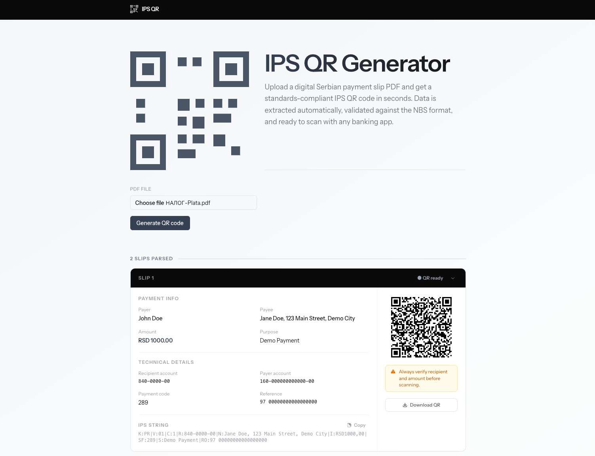

# IPS QR Generator

Serbian banks issue payment slips (`uplatnice`) as PDFs. Banking apps can scan IPS QR codes to prefill payment details, but the PDFs themselves often don't include one — just structured text. This tool bridges that gap.

Upload a PDF, get the IPS QR code back. Multiple slips per PDF are supported.

The PDF is processed server-side using `pdftotext -layout`, which preserves the two-column structure typical of Serbian payment slips. Fields are parsed and validated against the [NBS IPS QR standard](https://nbs.rs/sr_Latn/stanovnistvo/elektronsko-bankarstvo/ips/index.html) before the QR payload string is assembled. Account number checksums are verified with MOD 97 — if something doesn't pass, the QR isn't generated for that slip rather than silently producing a broken code.



---

## Stack

- **PHP 8.4 / Laravel 13**
- **Inertia.js v2 + Vue 3**
- **Tailwind CSS v4**
- **[spatie/pdf-to-text](https://github.com/spatie/pdf-to-text)** — thin wrapper around `pdftotext`

---

## Requirements

- PHP 8.4+
- Node 20+
- `pdftotext` CLI (part of [poppler-utils](https://poppler.freedesktop.org/))
- No database required — all processing is stateless

On macOS:
```bash
brew install poppler
```

On Ubuntu/Debian:
```bash
apt install poppler-utils
```

---

## Getting started

```bash
git clone git@github.com:nsvetozarevic/ips-qr-code-generator.git
cd ips-qr-code-generator

composer run setup
composer run dev
```

The `setup` script handles everything: installs dependencies, copies `.env`, generates the app key, and builds the frontend.

---

## Testing

```bash
php artisan test
```

Tests covering the PDF parser (including multi-slip PDFs, Cyrillic labels, edge cases in account number extraction), the IPS string builder (amount formatting, reference model fallbacks, checksum validation), and the HTTP layer.

---

## Limitations

The parser is written for the standard Serbian payment slip format. Slips with non-standard layouts or heavily scanned/rasterized PDFs (where `pdftotext` can't extract text) won't work. Only `RSD` currency is supported, matching the IPS spec.

Field labels are matched against Cyrillic, so payment slips with Latin labels aren't supported yet.
